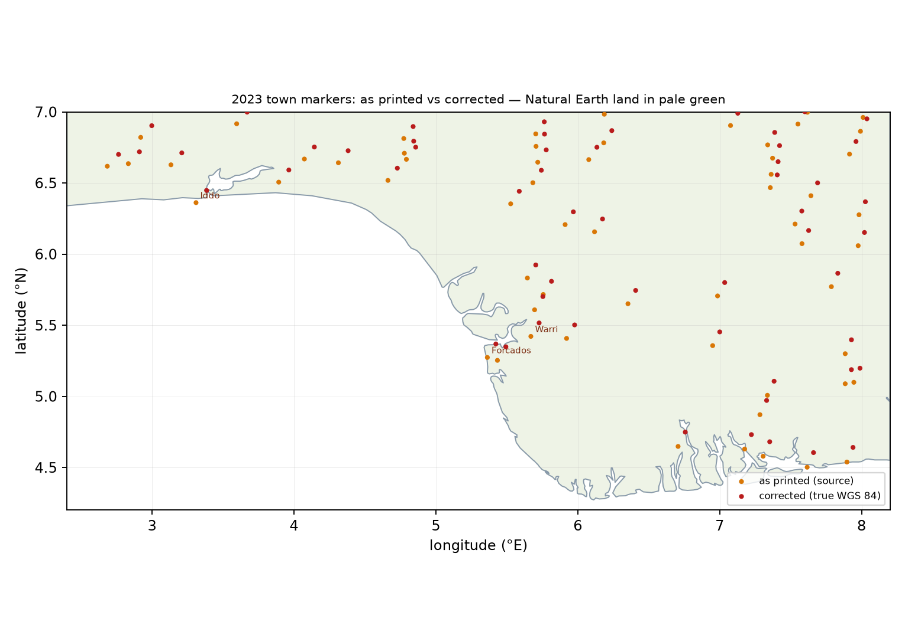

# CRS and coordinate accuracy

Short answers to the four questions: **yes, everything is EPSG:4326**; **the 2011 PDF carries no CRS at all and the 2023 PDF declares an ArcGIS placeholder (NAD 27 / Clarke 1866)** — but the two frames are otherwise the same projection, scale (to 0.016 %) and orientation; **yes, every coordinate-bearing attribute was moved with its geometry**; and **the hydrography and the national boundary are accurate to ~1 km, while the topographic overlay (towns, roads, capitals) is not** — it was printed with a ~0.66 % scale error and sits a median 11 km south-west of its true position on both sheets. The corrected coordinates are in `towns_true_wgs84.csv` and in the `*_wgs84` layers; every calculation-safety check is in **[VALIDATION.md](VALIDATION.md)**.

Everything below is reproducible:

```bash
python3 calibrate_maps.py --write     # re-reads the georeferencing + calibration metadata
python3 accuracy_check.py --true-csv  # re-measures against Wikipedia / Natural Earth, rewrites accuracy_report.json
python3 validate_coordinates.py       # 23 checks: CRS, geometry, attributes, units, land, frames
python3 make_true_layers.py           # writes the *_wgs84 point layers
```

**Before you compute with these files, run `validate_coordinates.py`** — it exits non-zero if any
check fails and writes `validation_report.json`. The rest of this page explains the numbers it prints.

---

## 1. What CRS do the two source PDFs carry?

| | 2011 geological sheet | 2023 mineral sheet |
|---|---|---|
| PDF georeferencing object | **none** — no `/VP`, `/LGIDict`, `/Measure` or `/UserUnit` in the page or the catalogue | **GeoPDF** `/VP[0]` → `/Measure /Subtype /GEO` with 4 corner `/GPTS` + `/LPTS` |
| Declared CRS | **none** (no projection statement in the text either) | `GEOGCS["GCS_Assumed_Geographic_1", DATUM["D_North_American_1927", SPHEROID["Clarke_1866",6378206.4,294.9786982]], PRIMEM["Greenwich",0], UNIT["Degree",0.0174532925199433]]` |
| How it was georeferenced here | affine fit to the **printed graticule**: 12 meridians + 10 parallels, 157.61 pt/degree, max residual **0.00105°** (≈120 m); derived scale 1:2,002,085 against the printed 1:2,000,000 | the `/VP` affine: 157.586 pt/degree, extent **3.83671–14.04668 °E / 2.47619–15.02138 °N**; parallels cross-check to ≤0.0009° |
| Datum | not stated; if the graticule was on the **Minna** datum (Clarke 1880) the WGS 84 difference is ~0.1–0.2 km — below the sheet's own accuracy | the declaration is the ArcGIS *"assumed geographic"* placeholder, not a real NAD 27 placement. **No datum shift is applied** (NAD 27 is not defined in Nigeria; a literal NAD27→WGS84 transform would move the map by hundreds of km) |

### Are the two frames otherwise the same?

| | 2011 | 2023 | difference |
|---|---|---|---|
| projection | Plate Carrée | Plate Carrée | none |
| scale (pt per degree) | 157.6121 / 157.6072 | 157.5864 / 157.5888 | **+0.016 % x, +0.012 % y** |
| tilt of meridians / parallels | 0.0000° | 0.0000° | none |
| printed scale | 1:2,000,000 | 1:2,000,000 | fitted 1:2,002,085 vs 1:2,002,411 |
| datum | unstated | ArcGIS "assumed" (NAD 27 / Clarke 1866) | no shift applied — see §1 and VALIDATION.md |
| embedded CRS | none | GeoPDF `/VP` | — |

So the frames agree to **185 m E-W / 163 m N-S accumulated across the whole 10.2 × 12.5° map face**
(0.09 mm on paper), and to **zero at the shared anchor** — the difference is a pure scale term, 18 m
per degree of longitude and 13 m per degree of latitude. They differ in the fifth decimal of the
scale, i.e. in nothing that could produce the 5–8 km offset you saw: that came from a displaced
raster layer *inside* the 2023 PDF.

Measured directly, **the same national-border line on the two sheets sits 38 m apart (systematic
bias), median 97 m, p90 231 m** over 22 559 vertices — a quarter of one printed line width
(0.2 mm at 1:2 M = 400 m). That is the real "same point on both maps" distance; the 185 m is the
worst-case frame term at the far edge and is included in it.

One quirk worth knowing: on the 2023 sheet the **printed meridian labels sit 0.172° (≈19 km) west of the graticule lines** in the `/VP` frame. The `/VP` values are the ones used, and they are confirmed independently: with them the national boundary agrees with Natural Earth to +0.25/+0.04 km and the rivers to −0.90/+0.50 km. The labels are a typographic offset, not a second georeference.

---

## 2. What CRS do the outputs carry?

| output | evidence |
|---|---|
| 33 shapefile `.prj` files (17 + 16 layers) | all identical: `GEOGCS["GCS_WGS_1984",DATUM["D_WGS_1984",SPHEROID["WGS_1984",6378137,298.257223563]],PRIMEM["Greenwich",0],UNIT["Degree",0.0174532925199433]]` |
| `nigeria_maps.gpkg`, `shapefiles/nigeria_geology.gpkg`, `shapefiles_minerals/nigeria_minerals.gpkg` | every row of `gpkg_geometry_columns` has `srs_id = 4326` |
| `viewer/build/data/*/*.geojson` | GeoJSON is WGS 84 by definition (RFC 7946); no `crs` member needed |
| viewer tiles | rendered on `L.CRS.EPSG4326` (`viewer/app.js:270`), i.e. a plain lon/lat grid, not Web Mercator |
| `calibration.json`, `viewer/build/data/*/meta.json` | now carry an explicit `crs` block: `"output": "EPSG:4326"`, plus the input declaration and the datum-shift statement |

So: **EPSG:4326 = WGS 84 geographic, degrees, Greenwich, north-positive** — the same CRS as GPS and OpenStreetMap.

---

## 3. Were the coordinates (not just the geometry) adjusted?

`calibrate_maps.py --apply` moves the geometry **and** every latitude column of the shifted layers, in the same loop:

| layer | geometry | latitude attributes moved | count |
|---|---|---|---|
| `rivers` | yes | `mid_lat`, `start_lat`, `end_lat` (re-derived again after the shift) | 876 |
| `roads` | yes | `mid_lat`, `start_lat`, `end_lat` | 115 |
| `railway` | yes | `mid_lat`, `start_lat`, `end_lat` | 6 |
| `mineral_symbols_raster` | yes | `lat` | 1 609 |
| `mineral_localities` | yes, for the ones placed on their raster symbol | `lat` **and** `label_lat` | 686 of 999 |
| `state_capitals` | yes, for the ones located on the raster square | `lat` | 14 of 33 |

Not moved, because they are text/vector content that was already in register with the 2011 sheet: `towns`, `map_labels`, `state_name_labels`, `river_labels`, `international_boundary`, the 313 label-centred localities and the 19 label-centred capitals.

Checks that the attribute/geometry pairs stayed consistent after the shift:

* every **point** layer: `lon`/`lat` equals the geometry to **≤5 × 10⁻⁷ °** (5 cm) — all 999 localities, 1 609 symbols, 483 towns, 33 capitals, 657 labels, 93 river labels, 23 pegmatite marks;
* every **line** layer: `mid_lon`/`mid_lat`, `start_*`, `end_*` and `length_km` were re-derived from the calibrated geometry (max deviation from the shapely midpoint: 5 × 10⁻⁷ °);
* the per-locality CSV (`mineral_localities.csv`) was shifted in the same pass; `lat` in the CSV equals `lat` in the DBF for all 999 rows.

Two columns are deliberately **not** rewritten, because they are extraction QA metrics measured in PDF points on the *source* document, not coordinates of the delivered data: `mineral_localities.snap_pt` and `mineral_symbols_raster.near_dist`. They are labelled "at extraction" in the viewer.

The correction itself (2023 sheet only):

```
dlat = (5.44 − 0.569·(lat − 9°)) / 110.57 °      north-positive;  8.0 km at 4.5°N, 5.4 km at 9°N, 3.2 km at 13°N
dlon = 0
```

In the rendered PDF this is applied as `1 0 0 0.994854 0 +12.93 cm` on the four displaced layers (`Image`, `Rivers`, `Roads`, `Railway`); the text, graticule, boundary and town markers are untouched.

---

## 4. Pinpoint check against online coordinates

Reference points: English Wikipedia coordinates (MediaWiki `prop=coordinates`) and Natural Earth 1:10 m populated places, rivers and 1:50 m admin boundary — none of them derived from either PDF.

### 4.1 Hydrography and national boundary — accurate

| check | 2011 sheet | 2023 sheet (calibrated) |
|---|---|---|
| rivers vs Natural Earth 1:10 m (median dE / dN, n) | **−0.38 / +0.12 km** (1 506) | **−0.90 / +0.50 km** (1 710) |
| national boundary vs Natural Earth 1:50 m (median dE / dN, n) | **+0.12 / +0.01 km** (39 525) | **+0.25 / +0.04 km** (31 833) |

These are the layers to trust for distance/area calculations.

### 4.2 Town markers — systematically wrong (source defect)

| check | 2011 sheet | 2023 sheet |
|---|---|---|
| 28 towns vs Wikipedia / Natural Earth (median dE / dN) | **−6.22 / −8.18 km** | **−6.16 / −7.63 km** |
| median radial error | **11.53 km** | **11.07 km** |
| 90th percentile | 13.41 km | 13.31 km |
| inside 5 km | **0 / 28** | **0 / 28** |

| place | true lon | true lat | map lon | map lat | dE km | dN km |
|---|---|---|---|---|---|---|
| Aba | 7.3667 | 5.1167 | 7.3366 | 5.0074 | −3.3 | −12.1 |
| Idah | 6.7433 | 7.0978 | 6.6787 | 7.0217 | −7.1 | −8.4 |
| Warri | 5.7500 | 5.5167 | 5.6695 | 5.4216 | −8.9 | −10.5 |
| Nsukka | 7.3958 | 6.8567 | 7.3387 | 6.7679 | −6.3 | −9.8 |
| Kontagora | 5.4730 | 10.4030 | 5.4421 | 10.3073 | −3.4 | −10.6 |
| Kaura Namoda | 6.5897 | 12.6000 | 6.5224 | 12.5491 | −7.4 | −5.6 |
| Wukari | 9.7833 | 7.8500 | 9.7673 | 7.7812 | −1.8 | −7.6 |
| Iseyin | 3.6000 | 7.9667 | 3.5089 | 7.9132 | −10.0 | −5.9 |
| Ilaro | 3.0170 | 6.8900 | 2.9200 | 6.8207 | −10.7 | −7.7 |

The maps are not merely noisy: **the same town is in the same wrong place on both sheets** (2023 − 2011 = 0.0/+0.5 km), which is why the text-to-text register check looked perfect while the absolute positions are 11 km out. The clearest visual proof is Idah: the town marker is printed on the **west** bank of the Niger, while the real Idah is on the **east** bank, 10 km north-east.

### 4.3 Why: the topographic overlay is 0.66 % under scale

Fitting an affine field to 54 matched town points (both sheets, Ogoja excluded because its Wikipedia coordinate is rounded to 0.5°):

```
dE = 0.716·lon − 0.142·lat − 9.78   km      rms 2.01 km   (before: 6.79 km)
dN = −0.127·lon + 0.736·lat − 13.78 km      rms 1.95 km   (before: 8.51 km)
```

The two scale terms are 0.716 km/degree and 0.736 km/degree — **0.65 % and 0.67 %**, i.e. a single uniform **0.66 % scale error of the topographic base** (a 1:2 M base printed at ≈1:2,013,000), anchored outside the sheet to the north-east. That is a property of the NGSA base map, not of the georeferencing: the raster, the rivers and the boundary do **not** carry it.

### 4.4 Corrected town coordinates

`shapefiles/towns_true_wgs84.csv` and `shapefiles_minerals/towns_true_wgs84.csv` apply the inverse of that field to every named town marker:

| column | meaning |
|---|---|
| `lon_map`, `lat_map` | the coordinate as printed on the sheet (same as the shapefile) |
| `lon`, `lat` | model-corrected true WGS 84 position |
| `de_km`, `dn_km` | correction applied (model value, negative = the map is west/south of truth) |

Residual after the correction, on the 28 control points: **median 2.3 km, p90 4.5 km, max 6.0 km** (Ogoja, whose reference is coarse, reaches 28 km and is the one point where the correction can mislead).

Checked once more against a **second, independent** reference set — the 68 Natural Earth 1:10 m
populated places in Nigeria (not used to fit anything):

| | median | p90 | inside 5 km | inside 10 km |
|---|---|---|---|---|
| as printed (n=44) | 11.1 km | 15.5 km | 2 % | 34 % |
| model-corrected (n=44) | **2.7 km** | 7.3 km | **82 %** | 91 % |

### 4.5 The same correction as layers

`make_true_layers.py` writes, for both datasets, `towns_wgs84` and `state_capitals_wgs84` — the
corrected geometry plus `lon_map`/`lat_map` (as printed), `de_km`/`dn_km` (correction applied),
`move_km`, `on_land`, `coast_km` and `corr` (which rule was used) per feature. They are in the
GeoPackages and are the layers the viewer draws by default.

The rule is not the same for every layer, because the sheets are not uniformly wrong:

| layer | follows the 0.66 % field? | evidence | corrected median error |
|---|---|---|---|
| 2011 towns | **yes** | r = 0.58 E / 0.69 N vs the field | 11.5 → **2.3 km** |
| 2023 towns | **yes** | same field, measured on both sheets | 11.1 → **2.7 km** |
| 2023 capitals | **yes** | label-centred group r = 0.75 N | 9.2 → **6.6 km** |
| 2011 capitals | **no** | offsets uncorrelated with the field; correcting makes it worse | 7.3 km (left alone) |

The 2011 capital names were evidently placed individually rather than inherited from the topographic
base; their positions are scattered ±7 km around the truth but have no systematic bias, so the
correction is deliberately **not** applied to them (`corr = 'none (label is unbiased)'`).

The shapefiles themselves, and the rendered tiles, still show the topographic overlay as printed. The CSV is the version to use when a town coordinate has to be within a couple of km; the hydrography/boundary layers are the version to use when it has to be within one.

---

## 5. What to use for calculations

| task | layer | accuracy |
|---|---|---|
| distance to a river, catchment, coastline, national border | `rivers`, `major_rivers_*`, `international_boundary` | ≤1 km (median ~0.5 km) |
| mineral locality positions | `mineral_localities` (686 on symbols) / `mineral_symbols_raster` | raster-derived; georeference ≤1 km, source symbol drawing ±1–2 km |
| geometry of the 2011 geology | `geology_units`, `faults`, … | ≤1 km (graticule fit 120 m + drawing) |
| town / capital coordinates | **`towns_wgs84`, `state_capitals_wgs84`** (or `towns_true_wgs84.csv`) | ~2–3 km median after correction; 11 km as printed |
| reproducing the map picture | `towns`, `state_capitals` (as printed) | 11 km as printed — do not use for coordinates |

---

## 6. Does every point fall on land?

Tested against the Natural Earth 1:10 m land polygons (independent of both PDFs) **and** against the
2011 sheet's own sea polygon:

| layer | on land | in water | verdict |
|---|---|---|---|
| `towns` (as printed) | 481/486 (2011), 479/483 (2023) | Cotonou, Iddo, Bori, Ete | **printed in the sea** — the 0.66 % error |
| `towns_wgs84` (corrected) | 484/486, 480/483 | Iddo, Forcados, Degema — 0.07–0.60 km from the shoreline | OK (delta waterfront) |
| `state_capitals` (as printed) | 32/32, 32/33 | Port Harcourt 0.3 km off | source error |
| `state_capitals_wgs84` | **32/32, 33/33** | none | OK |
| `mineral_localities` | 996/999 | Ipepe 1.8, Bomu 1.2, Badagry 1.0 km | OK (estuary / lagoon shore) |
| `mineral_symbols_raster` | 1607/1609 | 2 blobs ≤2.6 km | OK (symbols in the creeks) |
| `pegmatite_marks`, `volcanic_plugs` | all | none | OK |

The worst case is **Port Harcourt** (2023 sheet): as printed at 6.9622 E / 4.6988 N it is **0.3 km
offshore** and 13 km from the real city; corrected (7.0113 E / 4.7995 N) it is on land, and the
`state_capitals_wgs84` check is **33/33**. Cotonou (2011 sheet only) is a neighbouring-country town
printed 6.5 km offshore.



Every point in the `*_wgs84` layers carries `on_land` and `coast_km`, so a calculation can filter
or flag waterfront sites itself.

## 7. Reproduce

```bash
python3 calibrate_maps.py --write          # georeferencing + calibration metadata (incl. the crs block)
python3 accuracy_check.py --true-csv       # external pinpoint check + corrected town CSVs
python3 fix_derived_fields.py              # derived columns, polygon repair, CSV/DBF consistency
python3 validate_coordinates.py            # 23 checks -> validation_report.json (exit 1 on FAIL)
python3 make_true_layers.py                # the *_wgs84 point layers (on_land, coast_km)
python3 viewer/build_data.py               # tiles + GeoJSON + meta (carries the crs block)
python3 build_project_gpkg.py              # the single-file bundle
```

`accuracy_report.json` holds the machine-readable version of every number above.
