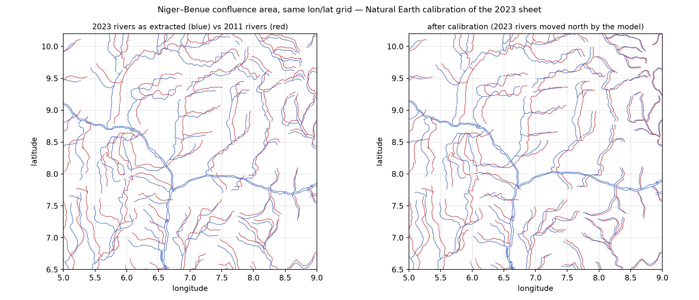

# Geological Map of Nigeria (NGSA, 1:2,000,000) – PDF analysis & shapefile extraction

Source file: `ilide.info-geological-map-of-nigeria-pr_a0987e407d194cb02682ac479336acb1.pdf`
(44 × 24.5 in, single page, created with **ESRI ArcMap 9.2.0.1324** on 2011‑01‑30).

> **CRS & coordinate accuracy:** outputs are **EPSG:4326**; the 2011 PDF declares no CRS and the 2023 GeoPDF
> declares an ArcGIS placeholder (NAD 27 / Clarke 1866). The national boundary, coastline and geology are on the
> true WGS 84 grid to ≈1 km (coastline: −0.4 km); the **rivers are the weakest layer** (2–5 km, two different 1:2 M drawings, see
> **[RIVERS_COMPARISON.md](RIVERS_COMPARISON.md)**); the two sheets' topographic overlay (towns, roads, capitals)
> carries a 0.66 % scale error.
> Details and the attribute-by-attribute audit: **[ACCURACY.md](ACCURACY.md)**; the calculation-safety
> checks (29 of them) and the corrected `*_wgs84` point layers: **[VALIDATION.md](VALIDATION.md)**.

## 1. Is it a GeoPDF?

**No.** It is a *layered vector PDF*, not a georeferenced one:

| Check | Result |
|---|---|
| ISO 32000‑2 / Adobe geospatial extension (`/VP` viewports + `/Measure` `/GEO` dictionaries, `/GPTS`, `/GCS` WKT) | **absent** |
| TerraGo GeoPDF (`/LGIDict` registration/projection dictionary) | **absent** |
| PDF layers (`/OCProperties`, Optional Content Groups) | **present – 125 layers**, one per geological unit + Rivers, Roads, Railway, Towns, State boundaries, Faults, Geological boundary classes, Labels … |
| Raster images | none – the whole map face is vector paths (45 625 paths, 15 093 text runs); the only image is the NGSA logo |
| Feature attribute tables (ArcGIS "Export PDF Feature Attributes") | **absent** (only added in ArcGIS 9.3) |

ArcMap 9.2 could export layers but **not** georeferencing (the "Export Map Georeference Information" option arrived in 9.3), so GIS software (QGIS/GDAL, ArcGIS, Avenza) opens this file as a plain, un‑placed drawing.

However, the map carries a full 1° graticule (3°–14° E, 4°–13° N) whose lines and labels are vector objects, and longitude and latitude are equally spaced (157.6 pt / degree in both axes = an unprojected, equirectangular data frame at 1:2 000 000). An affine transform fitted to those 22 graticule lines places the drawing in geographic coordinates with a residual of ≈0.001° (~100 m, well below the 1 pt ≈ 700 m drawing resolution). See `shapefiles/georeferencing.json`.

## 2. Can the shapefiles be extracted?

**Mostly yes – the geometry is complete; attributes have to be rebuilt from the layer names, legend and map labels.** `extract_shapefiles.py` does that and the results are in `shapefiles/` (WGS 84, EPSG:4326 `.prj`) plus a single‑file bundle `shapefiles/nigeria_geology.gpkg`.

| Output | Features | What it is / quality |
|---|---|---|
| `geology_units.shp` | 1 542 polygons | Every geological‑unit polygon from the ~100 unit layers, holes rebuilt with the PDF even‑odd rule, all geometries valid. Summed area 924 555 km² (Nigeria = 923 768 km²) – coverage is complete. Attributes: `unit` (PDF layer name = lithology), `fill` (colour), `code` (legend code, matched by colour + description; `code_src` says whether it came from the legend, the map label inside the polygon, or the layer majority), `leg_code`/`leg_desc`/`leg_row`, `lbl_code` (code printed on the map inside the polygon), `area_km2`, `perim_km`, `cen_lon`/`cen_lat`, `dup_of` (16 exact duplicate polygons exist in the source data), and the **stratigraphy read from the printed legend**: `formation`, `strat_grp`, `age_print`, `series`, `period_prt` (the words printed next to the swatch), `eon`, `era`, `period`, `epoch`, `age_ma_min`/`age_ma_max` (ICS 2023 equivalents), `rock_cls`, `basins`, and `age_src` (how the age was read, incl. every fall-back). 1 533 of the 1 542 polygons are dated – see [ATTRIBUTES.md](ATTRIBUTES.md). |
| `by_layer.zip` | 125 files | The same polygons split one shapefile per original PDF layer (e.g. `006_Alluvium.shp`), plus the raw, un‑merged line fragments of every line layer. |
| `geological_boundaries.shp` | 2 819 lines | `class` = exact / approximate / inferred / transitional. The dashed classes were exported by ArcMap as individual dashes (≈23 000 pieces); consecutive dashes were re‑chained into lines (`n_frag` = pieces merged). Joins at junctions can be imperfect – the polygon edges in `geology_units` are the authoritative boundaries. |
| `faults.shp` | 648 | major fractures/faults + inferred fractures (dashes re‑chained) |
| `fold_axes.shp` | 90 | anticlinal / synclinal axes |
| `younger_granite_outlines.shp` | 59 | outlines of the Jos‑Plateau ring complexes (18 are closed rings) |
| `volcanic_plugs.shp` | 68 points | centre of each plug/pipe marker, with the unit it sits in (no plug names are printed) |
| `rivers.shp`, `major_rivers_poly.shp`, `major_rivers_outline.shp` | 1 054 / 4 / 72 | rivers as drawn (`len_km`); the water polygons named Gulf of Guinea, Lake Chad, River Niger / River Benue and one unnamed reservoir (`kind`, `area_km2`, `perim_km`, bounds) |
| `state_boundaries.shp` | 83 lines | the continuous grey boundary band (the black dash‑dot on top is only symbol fragments, kept in `by_layer.zip`) |
| `roads.shp` | 122 | the road symbol is a double line, each road was exported twice ~1 km apart; the pairs were collapsed to centrelines |
| `railway.shp` | 6 | rail lines (the 294 cross‑ticks of the symbol were dropped) |
| `ridges.shp` | 2 | |
| `towns.shp` | 486 points | marker centres; 404 got their `name` from the label placed next to them (`name_dist` = match distance in pt); `lon`/`lat` and the rock unit under the point (`unit_code`, `unit`, `unit_era`, `unit_per`) |
| `state_capitals.shp` | 32 points | **approximate** – capitals have no marker in the PDF, only a halo label; point = label centre (checked against real coordinates: median error ≈7 km, max ≈15 km) |
| `labels.shp` | 1 973 points | every text string on the map face (unit codes, town names, water names) with font/size/angle, `lon`/`lat`, page position and text-box width; one‑character text runs were re‑assembled into words |
| `graticule.shp` | 22 | the fitted graticule (QA) – `label`, `length_km` |
| `legend.csv` | 92 rows | legend swatch colour → unit code → description, plus the full stratigraphic record per row (formation, printed age / series / period bracket, ICS eon–era–period–epoch, Ma range, rock class, basins, literature note, source of the age) read from the EXPLANATIONS panel – see ATTRIBUTES.md §1.1 for the table |
| `map_raster/` | PNG + `.pgw` | 150 dpi render of the map face with a world file, for overlay/QA |
| `preview.png` | | rendering of the extracted layers |

### Caveats – what is *not* recoverable or inherited from the source

* **No real attribute tables in the source.** The PDF carries no feature attributes; `unit`, `code`, `name`, and the whole stratigraphy are reconstructed from layer names, legend swatches, the legend's age brackets and the correlation chart, and from label placement (the derivation and the fill rate of every field are in [ATTRIBUTES.md](ATTRIBUTES.md)). Spot‑check before relying on a code: e.g. the map prints **OGe** on the polygons that the legend calls **OGm** (Medium‑ to coarse‑grained biotite granite) – both values are kept (`lbl_code` vs `leg_code`). The printed legend uses the code **MS** twice with the swatch colours swapped (mangrove swamps vs pelitic schist) – 13 polygons are assigned by position and say so in `age_src`. Six units are missing from the printed legend: **OGp** (246 polygons, 84 000 km² – the largest Older‑Granite unit) is dated from its code family and flagged; `Gdss`, `Gmsh`, `s`, `BCT` (9 polygons, 5 300 km²) stay undated.
* **Datum unknown.** The graticule gives geographic coordinates but not the datum; WGS 84 is assumed (Minna datum would differ by ~100–200 m, below drawing resolution).
* **Precision** is that of a 1:2 M drawing: 1 pt = 0.35 mm = ~700 m on the ground; the source data were themselves digitised at this scale.
* **Topology** is as in the source: 16 exact duplicate polygons, some overlaps between adjacent units (≈2 % of the area, mostly Alluvium and Bida‑basin units), small slivers.
* Dashed/decorated line symbols (boundary types, faults, fold axes, roads, railway) were re‑assembled heuristically from symbol fragments; use `by_layer.zip` for the raw fragments if you prefer to do that yourself.
* Layout elements (title, stratigraphic column, legend graphics, scale bar, logo) are not exported.

## 3. Reproducing

```bash
python -m venv .venv && . .venv/bin/activate
pip install pikepdf pymupdf shapely pyshp numpy pyogrio   # pyogrio only needed for the .gpkg bundle
python extract_shapefiles.py ilide.info-geological-map-of-nigeria-pr_a0987e407d194cb02682ac479336acb1.pdf shapefiles
```

The script parses the PDF content stream itself (paths, text and Optional‑Content tags), fits the graticule, rebuilds polygons/lines/points and writes the shapefiles; it runs in ~10 s.

## 3b. Register between the two sheets – external calibration (`calibrate_maps.py`)

The 2011 and 2023 sheets are two independent compilations, each georeferenced from its own
page (graticule fit vs GeoPDF `/VP`). Their **frames** agree with Natural Earth, but their
**content** does not:

| measured against Natural Earth 1:50m | 2011 sheet | 2023 sheet |
|---|---|---|
| national boundary (vector layer) | +0.1 / −0.0 km | +0.4 / +0.1 km |
| coastline (raster sea edge, median N–S, 23 longitudes) | **−0.4 km** | **−7.6 km** |
| 33 state capitals vs reference city coordinates | −0.5 / −1.0 km | **−6.3 / −6.8 km** |
| 2023 rivers+roads+railway vs the 2011 ones (74 tiles) | – | **+2.5 / −5.0 km** |
| 2023 town markers vs the 2011 ones (387 towns) | – | 0.0 / +0.5 km |

So on the 2023 sheet the **raster basemap and the linework traced over it** (rivers, roads,
railway, the mineral symbols and the capitals' raster squares) sit several km south of its own
frame, while the **text, the international boundary and the town markers** – the GIS-native
parts of the source ArcMap document – are in register *with each other* (text against text:
2023 − 2011 = +0.1 km E / +1.1 km N; their absolute accuracy is a separate question —
see **§3c**). Overlaid on the 2011 map, every raster-derived feature therefore
appeared *below* the 2011 feature for the same place ("geology above minerals").

`calibrate_maps.py` downloads the three Natural Earth layers it needs (public domain, from
`nvkelso/natural-earth-vector`; cached in `reference_data/`, git‑ignored), measures the
features above, and applies a latitude‑only affine fit to the three independent checks
(coastline at 23 longitudes, the 2023‑vs‑2011 linework at 74 tiles, the capital squares):

```
dlat = (5.44 − 0.569·(lat − 9°)) / 110.57   degrees   (north positive; 8.0 km at 4.5°N … 3.2 km at 13°N)
```

Longitude needs no correction (the boundary, the towns and the full‑width raster strips are
already in register). The correction is applied to the layers traced from the 2023 raster (`rivers`, `roads`,
`railway`, `mineral_symbols_raster`, and per feature: the 686 of 999 `mineral_localities` placed
on their raster symbol, and the 14 of 33 `state_capitals` located on the raster square) and,
when the viewer builds its tiles, to the matching layers of the 2023 PDF itself
(`viewer/build_data.py → patch_pdf_layers` wraps the basemap and the rivers/roads/railway in a
nested `cm` transform). The text, the graticule, the international boundary and the town
markers are left in place, so the picture moves with the vectors and stays on its labels. The national boundary, the towns and
the whole 2011 sheet are left untouched. Both datasets carry the measurement and the model in
`calibration.json`; the viewer shows them under *Compare ▸ Alignment*.

```bash
python calibrate_maps.py --report    # measure both sheets, print the table (no writes)
python calibrate_maps.py --apply     # write calibration.json + shift the 2023 content layers
python calibrate_maps.py --apply --force   # re-apply if the layers were rebuilt
python calibrate_maps.py --verify    # measure the calibrated output, record it in calibration.json
```

`extract_mineral_map.py` applies the calibration automatically when a `shapefiles_minerals/calibration.json`
exists, so a fresh extraction is calibrated even when this script is run on its own. `--report` measures the raw sheets (the 2023 linework still 5 km south of
the 2011 one), `--verify` the calibrated output (tiles + shapefiles):

| after the correction (`--verify`) | value |
|---|---|
| 2023 coastline vs Natural Earth (viewer tiles) | −0.2 km (2011: −0.3 km) |
| 2023 linework minus 2011 linework | 0.0 km in latitude (was −5.0 km) |
| 2023 capitals vs reference coordinates | −1.1 km in latitude (was −6.7 km) |
| 2023 town markers (left uncorrected, already in register) | +0.5 km |
| 2023 text vs 2011 text (left uncorrected, already in register) | +0.1 / +1.1 km |



*Niger–Benue confluence area on the same lon/lat grid: left, 2023 rivers as extracted (blue)
against the 2011 rivers (red); right, after the calibration. After the correction the 2023
linework is 0.0 km from the 2011 linework (median) and both coastlines agree with Natural Earth
to ≈0.2 km in the viewer tiles; on the raw vectors the residual is the ±2–3 km drawing noise of
the two 1:2 M compilations (`python calibrate_maps.py --verify`).*

## 3c. Absolute accuracy – what the register check does **not** say

§3b is a *register* check: it proves that the same feature is drawn in the same place on
both sheets. It does not prove that either sheet is on the true WGS 84 graticule.

Measured against **external** coordinates (English Wikipedia + Natural Earth 1:10 m, none of
them derived from these PDFs; `accuracy_check.py`):

| layer | 2011 | 2023 (calibrated) |
|---|---|---|
| rivers vs NE 1:10 m (median) | −0.38 / +0.12 km | −0.90 / +0.50 km |
| national boundary vs NE 1:50 m | +0.12 / +0.01 km | +0.25 / +0.04 km |
| **28 town markers vs Wikipedia** | **−6.22 / −8.18 km** | **−6.16 / −7.63 km** |
| median radial error of the towns | **11.5 km** | **11.1 km** |
| towns inside 5 km | 0 / 28 | 0 / 28 |

So the raster, the hydrography and the boundary are on the WGS 84 graticule, but the
**topographic overlay** (towns, roads, railway, capital squares) is not: it was plotted with a
**0.66 % scale error**, which displaces it by ~5 km in the north-east and ~15 km in the
south-west. Because both sheets share the same base, the error cancels in the §3b register
check — the 2023 towns are 0.5 km from the 2011 towns — and survives in every absolute
comparison. The giveaway is Idah, whose marker is printed on the **west** bank of the Niger
while the town is on the **east** bank, 10 km upstream.

The affine field fitted to 54 control points (both sheets) is

```
dE = 0.716·lon − 0.142·lat − 9.78  km      dN = −0.127·lon + 0.736·lat − 13.78 km
```

with 2.0 km rms after the fit (6.8 / 8.5 km before). `accuracy_check.py --true-csv` applies
its inverse to every named town marker and writes `shapefiles*/towns_true_wgs84.csv`
(`lon_map/lat_map` as printed, `lon/lat` corrected, `de_km/dn_km` applied). Residual on the
control points: **median 2.3 km, p90 4.5 km**. The shapefiles and the rendered tiles keep the
topographic overlay as printed; the CSV is the version to use when a town coordinate has to be
within a couple of km.

Full details, including the CRS of the two source PDFs and the attribute-by-attribute
coordinate audit: **[ACCURACY.md](ACCURACY.md)**.

## 3d. Calculating with the files – pre-flight check

`validate_coordinates.py` runs 29 checks and exits non-zero on any failure, so it can gate a
pipeline:

```bash
python3 validate_coordinates.py --quiet     # VALIDATION PASS (26 pass, 3 warn, 0 fail)
```

It checks the CRS of every file, geometry validity, attribute-vs-geometry agreement, the derived
`length_km`/`area_km2` against an independent WGS 84 geodesic, surface coverage (the geology union
covers 98.8 % of Nigeria with 2.3 % overlap between polygons), the two PDFs' frames (same
projection, 0.016 % scale difference, no rotation, no datum shift), and whether every settlement /
locality point falls on land.

**Points that land in the sea.** The two sheets' topographic base is 0.66 % under scale, so as
printed Port Harcourt sits 0.3 km offshore and 13 km from the city, and Cotonou 6.5 km offshore.
`make_true_layers.py` writes `towns_wgs84` / `state_capitals_wgs84` for both datasets: corrected
geometry, `lon_map`/`lat_map` as printed, `de_km`/`dn_km`, `move_km`, `on_land` and `coast_km`.
They are in the GeoPackages and drawn by default in the viewer. With them, **33/33 state capitals
and 480/483 towns are on land** — the three exceptions are delta waterfronts 0.07–0.60 km from the
Natural Earth shoreline.

The rule is applied per layer, not blindly: the 2011 **towns** do carry the field (r = 0.58/0.69;
11.5 → 2.3 km), but the 2011 **capital names** were placed individually and are unbiased, so they
are left where the sheet puts them (7.3 km median jitter, no bias). Each `*_wgs84` feature records
which rule was used in its `corr` field.

| use for | layer |
|---|---|
| settlement coordinates in a calculation | `towns_wgs84`, `state_capitals_wgs84`, `towns_true_wgs84.csv` (median 2.7 km) |
| reproducing what the sheet prints | `towns`, `state_capitals` (median 11 km off — not for coordinates) |
| border, geology units | `international_boundary`, `geology_units` (≈1 km) |
| rivers — topology only, which side of a channel | `rivers`, `major_rivers_*` (2–5 km of position; see [RIVERS_COMPARISON.md](RIVERS_COMPARISON.md)) |

## Project GeoPackage – everything in one file

`nigeria_maps.gpkg` (20.6 MB, EPSG:4326) bundles the whole project for QGIS / ArcGIS / GDAL:

| tables | content |
|---|---|
| `geology2011_*` (17 feature layers) | every layer of `shapefiles/` – rock units with era / period / epoch / Ma, boundaries, faults, rivers, roads, towns, labels … |
| `minerals2023_*` (16 feature layers) | every layer of `shapefiles_minerals/` – the 999 localities with codes, minerals, commodity groups and host geology, symbols, zones, rivers, towns, labels … |
| `geology2011_map_pdf`, `minerals2023_map_pdf` (tile layers) | the two PDF pages rendered and georeferenced (zoom 4–8, 0.0027°/px ≈ 300 m; GDAL/QGIS open them as ordinary rasters with overviews) |
| `geology2011_legend`, `…_summary_area_by_unit`, `…_summary_area_by_age` | the printed legend with ages, and the area statistics |
| `minerals2023_legend`, `…_code_dictionary`, `…_explanations_table`, `…_summary_localities_by_host_geology`, `…_summary_localities_by_group` | the mineral legend, every code with meaning / group / confidence, the full EXPLANATIONS table (with `resolved_as` / `resolution_evidence` for the codes this project resolved), the locality statistics |
| `minerals2023_symbol_identification` | the symbol-identification pass (§4): one row per raster symbol blob with its single mineral, method, score, margin and evidence |
| `project_layers` | catalogue: one row per table (source map, kind, geometry, feature count, source file, description) |
| `gpkg_metadata` | project description, both georeferences, accuracy note, build date (JSON) |

```bash
python build_project_gpkg.py              # rebuild (3 s when the viewer tiles exist, otherwise renders them first)
python build_project_gpkg.py --zmax 9     # finer PDF rasters (≈150 m/px, +25 MB)
python build_project_gpkg.py --check      # integrity + GDAL raster check (pip install rasterio for the latter)
```

Field names are the shapefile names documented in [ATTRIBUTES.md](ATTRIBUTES.md); the per-map GeoPackages
(`shapefiles/nigeria_geology.gpkg`, `shapefiles_minerals/nigeria_minerals.gpkg`) stay as before.

## 4. Live comparison viewer (mobile-first) – both maps

```bash
python viewer/serve.py          # then open http://localhost:8080  (bind: 0.0.0.0, flags: --port, --rebuild)
```

The first start runs `viewer/build_data.py` (~1–2 min; `--dataset geology|minerals|all`): it renders
both PDF pages to Leaflet EPSG:4326 tiles (zoom 4–9 ≈ 330 dpi) – the 2011 map placed with its fitted
graticule georeference, the 2023 map with its own GeoPDF `/VP` viewport – converts `shapefiles/` and
`shapefiles_minerals/` to GeoJSON and collects the QA statistics. Generated data lives in
`viewer/build/` (git-ignored: `tiles/`, `tiles_minerals/`, `data/`, `data/minerals/`). Extra
dependencies: `pymupdf pillow pyogrio` (plus the extraction dependencies above for the statistics).
A dataset whose PDF or shapefiles are missing is simply skipped by the viewer.

What the viewer offers (designed for a phone screen, works on desktop too):

* **Swipe** – an original PDF on the left of a draggable divider, extracted layers (drawn with a
  matching symbology) on the right; **Overlay** – extracted layers over the PDF with an opacity
  slider; **PDF only** / **Extracted** – one at a time. Which PDF is on the "PDF side" (2011
  geology or 2023 minerals) is chosen with the first chip above the map or under *Layers*.
* **Layers** – the 17 geological-map layers and the 16 mineral-map layers (plus the printed mineral
  numbers drawn as text) are listed in two groups, each with its own on/off switch, group-level
  *All on / All off* and a *Units only* / *Minerals only* shortcut. Both maps share one lon/lat
  grid, so e.g. mineral localities can be switched on over the 2011 geology units (the 2023
  content is calibrated to the 2011 sheet and to Natural Earth – see §3b – so features overlay:
  the residual is the ±2–3 km drawing noise of the two 1:2 M compilations).
* Tap any extracted feature for its full attribute table; a rock unit opens with its stratigraphy
  strip (era · period · epoch · Ma · the words printed in the legend, with an "inferred" flag when a
  fall-back was used); a mineral locality shows its EXPLANATIONS-table row, its commodity groups,
  how its point was placed (on the matched raster symbol = solid outline, on the printed number =
  dashed outline) and the 2011 geology unit beneath it.
* **Colour rock units by** printed legend colour, era, period or rock class (select under *Layers*,
  with a key and polygon counts).
* **Legend** – `legend.csv` of the 2011 map, each row with its formation and age, with "highlight
  this unit", the 67 mineral legend symbols
  cut from the 2023 PDF with locality counts and "highlight localities with this mineral", and a
  locality finder (number such as `B 12`, name or mineral).
* **Compare** – the GeoPDF verdict and PDF-primitive vs feature counts for the 2011 map; the
  georeference check, table/number/symbol matching statistics and the capital-city test for the 2023
  map; attribute statistics (area by era / rock class / period, localities by commodity group and by
  host geology). Quick zooms: Jos Plateau, Niger Delta, Lake Chad, Sokoto, the 2011 legend panel, the 2023
  EXPLANATIONS table.

---

# Mineral Resources Map of Nigeria (2023) – GeoPDF → shapefiles

Source file: `Mineral_Resources_Map_of_Nigeria_2023.pdf` (55 × 30 in, single page, **Esri ArcMap 10.2.2**, 2023‑08‑17).
Script: `extract_mineral_map.py` → outputs in `shapefiles_minerals/` (WGS 84 `.prj`) + `shapefiles_minerals/nigeria_minerals.gpkg`.

## 1. Is it a GeoPDF?

**Yes.** The page carries an ISO‑32000 geospatial viewport (`/VP` → `/Measure` `/GEO`, four corner `/GPTS`, `/GCS` WKT), so GDAL/QGIS/Avenza place it directly. The frame runs 2.47619–15.02138 °E × 3.83671–14.04668 °N, lon/lat are linear in page coordinates (Plate Carrée data frame, 157.586 pt/°); the transform is in `shapefiles_minerals/georeferencing.json`.

Two things to know about that georeference (both recorded in `georeferencing.json`/`qa_report.json`):

* The declared CRS is `GCS_Assumed_Geographic_1` (ArcGIS' placeholder for "lat/lon, datum unknown", nominally NAD27/Clarke 1866). The data are plainly Nigerian lat/lon; outputs are written as EPSG:4326 – the datum difference is far below the ≈1 km symbol resolution.
* The **printed meridian labels disagree with the embedded georeference by 0.172 ° (≈19 km)**: the lines labelled 4…14 °E sit at 4.17…14.17 °E in the `/VP` affine (parallels agree to < 0.001 °). An independent check against the 33 state‑capital markers shows the `/VP` affine is the better of the two (mean offset −7 km E / −7 km N, rms 11 km; shifting to the meridian labels would make it −26 km E), so `/VP` is used for every layer and the `graticule` layer carries both values (`printed`, `vp_value`).

## 2. What is in the PDF, and what the layers carry

Unlike the geological map, only part of this map is vector. The **background geology, the mineral symbols and the state‑capital squares are a raster** (7 image strips, 2060 × 1677 px ≈ 75 dpi); the vector layers are Roads, Rivers, Railway, International boundary, division lines, Towns (circles), Graticule, and all text (town/capital/state/river names, mineral numbers, the EXPLANATIONS table and legend text). The map locates mineral occurrences by a **number printed on the map** which is resolved through the EXPLANATIONS table (seven numbering zones A–G, each restarting at 1), and by a **coloured legend symbol** next to the number. The extraction therefore joins three sources: the number labels (vector text), the table (vector text) and the symbols (raster blobs).

| Output | Features | What it carries |
|---|---|---|
| `mineral_localities.shp` / `.csv` | 999 points | One point per mineral number printed on the map. `zone`, `number`, `zone_num` (e.g. `E109`); from the table join: `locality`, `codes_raw` (as printed), `minerals` (expanded names), `min_conf` (certain / legend / probable / uncertain / unknown per code), `match` (995 `exact`, 76 of them `exact (number printed 2x in zone …)`, 4 `number not in table`), `n_printed`, `tbl_flags` (`none` when the row carries no flag). Position: `pos_src` = `raster symbol (colour-consistent)` for the numbers whose legend symbol was found within 25 pt – the point is the symbol centre, `snap_pt` the distance – otherwise `label centre` (the number itself; `snap_pt` then holds the distance to the nearest symbol). `label_lon/lat` always hold the number's own position; `lon`/`lat` the final point. `symbol` / `sym_method` / `sym_score` / `sym_evid` carry the single identification of the symbol at the number (see §4 below). Added attributes: `n_minerals`, `mineral_1`, `group_1`/`groups` (commodity groups), `n_unknown`, and the host rock unit from the 2011 geological map (`geo_code`, `geo_unit`, `geo_form`, `geo_era`, `geo_period`, `geo_epoch`; ±10 km, see ATTRIBUTES.md §2) – every field carries an explicit value, never an empty one. |
| `explanations_table.csv` | 1 171 rows | The complete EXPLANATIONS list (A 103, B 165, C 86, D 157, E 234, F 202, G 224 rows), parsed from the eight text columns: `zone`, `number` (sequential, see caveats), `number_printed`, `locality`, `codes_raw`, `codes`, `minerals`, `code_confidence`, `unknown_codes`, `on_map` (958 rows have their number on the map, 213 do not), `flags`, `table_column`, `raw_text`. |
| `mineral_symbols_raster.shp` | 1609 points | Every coloured symbol blob detected in the raster (including the parts of merged ink bodies, see §4): `colour` class, size, `fill` (solid / round / sparse – distinguishes e.g. the solid gold square from the lettered brine circle) and – from the identification pass of §4 – one definite `mineral` per blob with `ident_mth` (how it was determined), `ident_scr` (template‑match score where a match was used) and `ident_evid` (the corroborating fact), plus `link` + `near_*` (the number label it serves, if any). 95 of the 1609 blobs are determined to be map furniture or ink artefacts rather than mineral symbols (state‑capital squares, raster slivers, linework and label fragments, the Lagos‑Ibadan bridge marks, five merged clusters of different symbols) and say so in `mineral`. The 54 fragments in the raster's water‑line blue are excluded (no legend symbol has that colour). |
| `symbol_identification.csv` | 1593 rows | The identification pass as a table: blob index, signature, position, the single mineral, method, score, margin and evidence. |
| `mineral_legend.csv`, `legend_symbols/` | 67 rows, 66 PNGs | Legend order, mineral name, the code printed in the legend (only 19 entries have one), the table codes mapped to that mineral, cut‑outs of each legend symbol. |
| `mineral_code_dictionary.csv` | 120 codes | Every code used in the table → mineral, with confidence (36 certain, 20 from the legend, 30 probable, 15 uncertain, 19 unknown – e.g. `Us`, `Ke`, `Cy`, each used once or twice). |
| `map_zones.shp`, `division_lines.shp` | 7 / 5 | The A–G numbering zones polygonised from the division lines + frame (`tbl_rows`, `labels`, `n_local`, `n_symbols`, `area_km2`, `perim_km`, bounds, `top_grps` per zone; `length_km` and the zones separated per line). |
| `roads.shp` | 115 lines, 18 400 km | Double‑line symbol collapsed to centrelines (`n_frag` fragments merged). |
| `rivers.shp` | 876 lines, 43 200 km | As drawn (the vector river layer; lakes/large rivers are raster only). |
| `railway.shp` | 6 lines | The 114 white dash overprints of the symbol dropped. |
| `international_boundary.shp` | 1 line, 4 090 km | The red band; the black dashes of the symbol dropped. |
| `graticule.shp`, `map_frame.shp` | 11 / 1 | `axis`, `vp_value`, `printed`, `label`, `length_km`, `offset_deg` (see §1); the frame with area, perimeter, extent and nominal scale. |
| `towns.shp` | 483 points | 478 vector circles (`town marker`), 411 named from the label beside them (`name_dist` = marker‑to‑label distance), 67 without a legible name; plus 5 names whose circle is shared with/hidden by a neighbour (`name only (no marker)`, placed at the label). |
| `state_capitals.shp` | 33 points | Capitals have no vector marker – the grey square is in the raster, centred under the bold label. 14 were located on that square (`src = raster capital square`), the rest sit at the label centre (within ≈1 pt of the square where both exist). |
| `state_name_labels.shp` | 37 | the 36 states + FCT labels |
| `river_labels.shp` | 93 | water names; the italic names follow the river curves with one rotation per glyph, so the 532 glyphs are re‑assembled along the drawing order (`RIVER BENUE`, `Yedseram`, `Karkin Pawa` …), `n_glyphs` per name |
| `pegmatite_marks.shp` | 23 | the "P" pegmatite marks of the geology legend |
| `map_labels.shp` | 657 | every text string on the map face except the mineral numbers, with layer, `kind`, font, size, angle, `lon`/`lat`, zone and text-box size (river names as assembled above) |
| `geology_legend.csv` | 9 | the background‑geology legend order – the geology itself is raster only |
| `map_raster/` | PNG + `.pgw` | the untouched 75 dpi raster strips reassembled and world‑filed (`mineral_map_base_75dpi.png`, the actual symbol source) and a 150 dpi render of the full map face |
| `qa_report.json` | | all counts above, the unmatched numbers, snap statistics, the capital check, commodity-group counts |

Every point layer carries `lon`/`lat` (+ `zone`), every line layer `length_km`, `n_vert`, midpoint / start / end and `closed`; the full per-layer field list with fill rates is in [ATTRIBUTES.md](ATTRIBUTES.md) §2–4 (`python inventory_attributes.py --update-attributes-md` regenerates it). `python summaries.py` writes the cross-map summary tables (`summary_area_by_unit.csv`, `summary_area_by_age.csv`, `summary_localities_by_host_geology.csv`, `summary_localities_by_group.csv`).

### How the table/number join was verified

* Every zone's list is contiguous after parsing: the only numbers absent from the printed list are **F 110, G 53, G 86, G 111** (F110, G53 and G86 *are* printed on the map – those three labels are kept with `match = number not in table`). One printed number exists in no list (D 256, a misprint). Two lone `0` glyphs drawn in a separate pass of the content stream sit exactly one character to the right of other numbers (`46`→"460", `115`→"1150"); glyphs are grouped by geometry *and* drawing order so these are recognised as strays and dropped (`qa_report.json → stray_zero_glyphs_dropped`).
* 30 rows have a misprinted number that is unambiguous from its neighbours (e.g. `109. Kafin‑chiri` followed by `109 Kofin‑chini`, `53. Basuras` between 82 and 84) – `number` holds the sequential value, `number_printed` the print, `flags` says so. 10 numbers were printed in a broken font (`I`, `SI`, `SE`, `lOB`, `•7` …) and are inferred from the sequence; 2 entries carry a suffix in the source (B 17A, D 67A). All of these were checked against the rendered PDF.
* Three numbers printed on or just across a division line (F 9, F 10 = Obajana and E 15) fall geometrically in the neighbouring zone; the zone is chosen from the numbering sequence (consecutive numbers are placed close together) and the change is recorded in `qa_report.json → rezoned_by_numbering_sequence`. Every one of the 2 393 digit glyphs on the map is accounted for by exactly one label.
* Zone B's rows 156–164 are typeset at the foot of the D column; they are assigned to B by position (`TABLE_ZONE_OVERRIDES`). 118 rows had the mineral codes typed into the locality cell (`Orukpa C`, `AFU HILL Sn. Ta.Nb.W`, `Odaru (Gys)`, `IkpaBa`); they are split off only when every token is a known code (`flags = codes split from name cell`). Only 6 table rows print no code at all (B 109, E 73, E 75, F 155, F 175, F 187) – their points carry `group_1 = no code printed`.
* The table text has OCR-type letter glitches in 52 locality names (`lkorodu`, `Kaqoro`, `OrIu`, `HIlls`, `KAN0`); only patterns that are never a real spelling are corrected (word-initial `l` before a capital/consonant → `I`, `I` between lower-case letters → `l`, `q` not before `u` → `g`, `0` inside a capital word → `O`); every correction keeps the printed form in `flags` and `raw_text`.
* **38 numbers are printed twice on the map face** (e.g. A 97 twice, 20 pt apart; F 36 once near 37/33 and once 270 km away). Both copies are complete labels drawn in their zone's own sequence, so they are not assembly artefacts; each copy is kept, joined to the same table row, with `match = exact (number printed 2x in zone …)` and `n_printed = 2` (76 points; list in `qa_report.json → numbers_printed_more_than_once`). Where one copy sits on a colour-consistent symbol and the other does not, `pos_src` tells which.
* Symbol detection was calibrated on localities with a single mineral (gold = solid yellow 8 × 8 px square, clay = yellow 14 × 10 rectangle, kaolin = khaki rectangle, limestone = hatched green, tantalite = white bowl, barytes/gypsum = white ring arcs, lead‑zinc = red triangle …); a number is only snapped to a symbol whose signature is consistent with its minerals. Tin (`Sn`, 73 rows) and quartz/monazite/ruby codes have no legend symbol by design and stay at the label. Every blob is then given a single identification (§4).

### Layer audit – how each layer was checked

| Check | Result |
|---|---|
| Every digit glyph of the `mineral numbers` layer ends up in exactly one label | 2 393 glyphs → 999 labels + 2 stray `0` glyphs (dropped) – no glyph lost or double‑used |
| Table completeness | every zone's numbering is contiguous after parsing; the only numbers absent from the print are F 110, G 53, G 86, G 111; 30 misprinted numbers were corrected from neighbours and each was checked against the rendered table |
| Zone of labels near a division line | 229 labels lie within 20 pt of a line; the numbering‑sequence test moved 3 (F 9, F 10, E 15) – listed in `qa_report.json` |
| Join sanity against the map's own gazetteer | 105 localities are also named towns on the map; median label‑to‑town distance 22 km (the far outliers are towns that share a name, e.g. two Bidas, two Wawas) |
| Symbol snapping | rules calibrated on single‑mineral localities, then checked on rendered overlays (Zamfara gold belt, Jos Plateau) |
| State capitals | located on the raster capital square under the label (within ≈1 pt where the square is isolated); 33 capitals vs reference coordinates: rms 11 km, which is the accuracy of the map's own georeference |
| Towns | names matched by distance to the label box (median 1.2 pt, max 10.7 pt); checked on overlays in three regions |
| Roads / rivers / railway / boundary | overlays on the faded PDF in two regions – centrelines sit inside the double‑line road symbol, railway and boundary follow their bands, rivers coincide |
| Georeference | parallels on whole degrees to < 0.001°; meridian labels vs `/VP` discrepancy 0.172° resolved with the capital check (see §1) |
| Register with the 2011 sheet | frame and national boundary agree with Natural Earth to ≤0.5 km, but the raster basemap and the linework traced over it sat 5–8 km south of the frame; calibrated against Natural Earth (coastline, linework, capitals) – see §3b |

### Caveats

* **Positions**: 1 pt ≈ 0.7 km; a snapped point is the symbol centre (±1–2 px), an unsnapped one is the number's centre, which is typically 3–10 km from the deposit symbol. The `/VP` georeference places the frame correctly (the boundary agrees with Natural Earth to 0.4 km), but the content of the sheet was registered ~5–8 km south of that frame; the extracted layers are calibrated against Natural Earth (see §3b), which brings the capitals to within ≈1 km in latitude (the residual is the ±2–3 km drawing noise of a 1:2 M compilation).
* **Minerals come from codes typed by the map compiler**, with inconsistent spelling (`CI`/`Cl`, `MI`/`mi`, `PbS`/`Pbs`); confidence is recorded per code and 19 codes could not be resolved at all.
* Mineral symbols without a number are identified in the same pass as the numbered ones (§4): by their rendering signature, by fragment/furniture tests, and – where neither applies – by a size‑ and colour‑gated template match against the 66 legend symbols, whose score is kept in `ident_scr` so the strength of each single determination stays visible.
* Background geology, lakes and the large rivers exist only as raster.

## 3. Reproducing

```bash
pip install pikepdf pymupdf shapely pyshp numpy pillow scipy pyogrio   # pyogrio only for the .gpkg
python extract_mineral_map.py Mineral_Resources_Map_of_Nigeria_2023.pdf shapefiles_minerals   # ~10 s
```

## 4. Symbol identification – one mineral per printed symbol

The 2023 map prints its mineral symbols into a 75 dpi raster, so a symbol carries only 8–30 px of
information and the previous pipeline could only offer *candidate lists* per blob
("Gypsum | Baryte | Phosphate | …") – or nothing at all for 243 of the 1 593 blobs – while 20 codes of
the EXPLANATIONS table stayed "unknown code".  This pass replaces all of that with exactly one
determination per symbol and per locality, each with its method and evidence
(`symbol_identification.csv`, and the `mineral` / `ident_mth` / `ident_scr` / `ident_evid` fields of
`mineral_symbols_raster.shp`, `symbol` / `sym_method` / `sym_score` / `sym_evid` of
`mineral_localities.shp`).  No field anywhere in the mineral outputs is empty.

How each determination is made, in order of precedence (`symbol_identify.identify_all`):

1. **Signature determination** – the map face is a fixed-resolution raster, so one mineral symbol
   always renders to the same (colour class, pixel box, fill) signature.  Every signature that occurs
   more than once was read off the raster against the legend sheet and is written down in
   `symbol_decisions.GROUP_DECISIONS` with its evidence (and, where numbered localities sit on it,
   the EXPLANATIONS-table vote count that corroborates it).  Signatures whose artwork is identical
   at map resolution except for the interior glyph (the white circle‑with‑bar family Gypsum/Baryte/
   Phosphate/Trona/Bitumen, the purple octagon Talc/Molybdenite, …) are resolved per blob by template
   ranking inside that family – still one mineral per blob.
2. **The EXPLANATIONS table at the blob's number** – a blob that a printed number snaps to inherits
   that row's mineral whenever the row names a single legend mineral (or a member of the family).
3. **Fragment and furniture tests** – a blob that is half of a symbol cut by an overprint rejoins its
   host signature; slivers, linework bars, the grey state‑capital squares and the Lagos‑Ibadan bridge
   marks are determined to be *not mineral symbols* and say so.
4. **Template match** – otherwise the blob is matched against the 66 legend symbols at the map's own
   resolution, gated by printed size and dominant colour; the score and the margin over the runner‑up
   are kept (`ident_scr`), and a best score below 0.45 is reported as "no legend symbol matches"
   rather than guessed.

The 20 codes the legend does not define are resolved in `symbol_decisions.CODE_RESOLUTIONS`, one row
each, by reading the printed code cell at 900 dpi, the symbol the cartographer printed at that
locality's number, and – where no symbol is printed – single‑glyph confusion against the codes the
same zone of the table uses plus the host geology; e.g. `Us` = *Ls* (the symbol at A6/A7 is the
Limestone hatch), `Ke` = *Ka* (the khaki K square at D126/D148, Kwali being the type locality of
Nigerian pottery clay), `Sr` = *Br* (the yellow B circle at E161), `sT`/`Tn`/`In`/`Si` = cassiterite,
which carries no legend symbol and indeed has no symbol at those numbers.  `explanations_table.csv`
carries the resolution and its evidence per row (`resolved_as`, `resolution_evidence`).

### Second coverage pass – are any printed symbols missing?

`symbol_scan.py` cross-correlates the colour pattern of every legend symbol with the whole map face
(and checks every peak against the blob list), so a symbol the segmentation missed would show up as
an uncovered peak.  It found three genuine gaps, now closed:

* **Merged ink bodies.**  A colour component larger than any legend symbol of its colour (two
  touching Kaolin K squares, a Lepidolite rectangle merged with a Tourmaline triangle, …) used to be
  dropped or reported as one "cluster".  `extract_mineral_map.split_component` now closes the glyph
  strokes, erodes the contact neck and keeps the symbol-sized parts (19 parts in this run); where a
  body is two touching copies of the *same* symbol and no table row covers it, the pair carries one
  determination ("merged pair of touching symbols", method in `symbol_identification.csv`).
* **Calcite.**  Legend cell 67 prints no artwork, but the map face prints a blue‑violet triangle with
  a white C twice (raster px 240,732 and 986,866); the EXPLANATIONS code `Ca` of six localities maps
  to Calcite through that legend row.  The template (`legend_symbols/symbol_67_Calcite.png`) was cut
  from the map face at legend scale, the signature is recorded in `symbol_decisions.GROUP_DECISIONS`,
  and the template is used for signature determination only (never a visual match on fragments).
* **Nothing else.**  After the fixes the scan leaves no uncovered peak except two linework
  false-positives (a river bend and a road junction at score 0.80–0.82).

Conversely, seven legend minerals are **listed but never printed** on the map face – Asbestos /
Serpentine, Bitumen, Copper minerals, Nickel, Rose Quartz, Silver (best whole-map colour-pattern
score 0.30–0.47, always on another symbol) – plus Calcite's legend cell, which is empty; Psammite
occurs only as an area tint, not as point symbols.  They therefore carry no symbol rows, by
cartographic fact rather than by omission.

Result: 999 localities and 1 609 symbol blobs, each with exactly one mineral (or an explicit
"not a mineral symbol: …" class), 0 unknown codes, 0 candidate lists, 0 empty attribute values;
66 different minerals identified on the map face.
