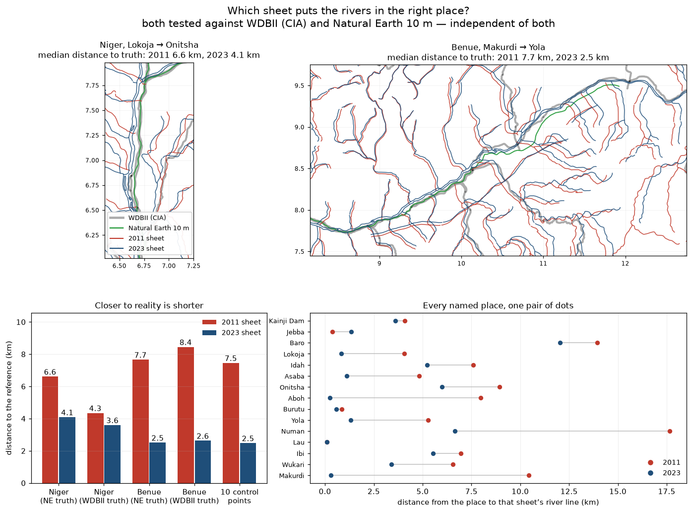

# Which sheet draws the rivers in the right place?

The two sheets draw the Niger and the Benue **3.7 km apart** (median), and no transform can
reconcile them — see [VALIDATION.md](VALIDATION.md). The question that follows is which of the two
is closer to reality. It can be answered, because river geometry is one of the best-mapped things
on Earth.

## What the new reference is

| reference | what it is | why it is independent |
|---|---|---|
| **WDBII** (CIA World Data Bank II) | the river layer distributed with `basemap-data` (GSHHG/WDBII, LGPL-3.0-or-later); digitised from aviation and navigation charts at 1:1–1:3 M | produced by the US Central Intelligence Agency in the 1980s – predates both sheets, used by neither |
| **Natural Earth 10 m rivers** | `ne_10m_rivers_lake_centerlines` (public domain), the modern standard small-scale reference | used to check the *frames*; no river geometry was ever fitted to it |
| **15 named control points** | published coordinates of places that stand on the two rivers (Lokoja, Idah, Onitsha, Asaba, Aboh, Makurdi, Yola, Numan …) | an independent third opinion, at point scale |

The two references agree with each other on the main stems to **0.4 km** (Niger) and **0.8 km**
(Benue) median, so they can be used as truth interchangeably. On the Niger between Lokoja and
Onitsha — the reach where the sheets disagree most — they still agree to **0.6 km**, while the
sheets are 2–9 km from them.

Reproduce with:

```bash
python3 fetch_reference_rivers.py     # WDBII + Natural Earth (cached in reference_data/, git-ignored)
python3 compare_rivers.py --figure    # table + rivers_which_is_right.png
```

## The measurement

Sample the reference main stem every ~2 km and measure the distance to the nearest line of each
sheet's network. Sampling **truth → sheet** (not nearest vertices in both directions) is the fair
test for "who drew it in the right place": a sheet is not penalised for drawing extra tributaries.

| truth | river | 2011 sheet | 2023 sheet | winner |
|---|---|---|---|---|
| Natural Earth 10 m | Niger | 6.6 km | **4.1 km** | 2023 |
| Natural Earth 10 m | Benue | 7.7 km | **2.5 km** | 2023 |
| WDBII (CIA) | Niger | 4.3 km | **3.6 km** | 2023 |
| WDBII (CIA) | Benue | 8.4 km | **2.6 km** | 2023 |
| 10 clean control points | both | 7.5 km | **2.5 km** | 2023 (9 of 10) |

For completeness, the 2023 rivers **before** their register correction (i.e. exactly as drawn on
the sheet): Niger 4.4 km / 4.0 km, Benue 1.9 km / 3.4 km against Natural Earth / WDBII. The
correction moves the numbers by 0.3–0.8 km in both directions and does not change the ranking.

Measured from the published coordinate itself rather than a snapped one: **8.6 km (2011) vs
2.0 km (2023)**.

Point by point (distance from the place to that sheet's river line, km):

| place | river | 2011 | 2023 |
|---|---|---|---|
| Lokoja (confluence) | Niger | 4.05 | **0.84** |
| Idah | Niger | 7.59 | **5.23** |
| Onitsha | Niger | 8.93 | **6.00** |
| Asaba | Niger | 4.82 | **1.12** |
| Aboh | Niger | 7.97 | **0.24** |
| Makurdi | Benue | 10.45 | **0.31** |
| Numan | Benue | 17.65 | **6.65** |
| Ibi | Benue | 6.95 | **5.54** |
| Jebba | Niger | **0.38** | 1.34 |

Jebba is the one place where the 2011 sheet wins, and it is a 1 km difference on a point where
both sheets are already inside a printed line width.



## Answer

**The 2023 (mineral) sheet is the one in the right place.** It is closer to truth in all four
reference/river combinations and at 9 of the 10 clean control points:

* **Benue** — decisive: 2.5–2.6 km vs 7.7–8.4 km. The 2011 Benue is about three times further out.
* **Niger** — consistent but narrower: 3.6–4.1 km vs 4.3–6.6 km, depending on which reference you
  believe (the two references themselves differ by ~2 km along this reach).
* **Control points** — 2.5 km vs 7.5 km median. At Lokoja, Makurdi, Aboh and Asaba the 2023 line
  passes within 0.3–1.1 km of the town; the 2011 line misses by 4–10 km.

Two honest caveats:

* **Neither sheet is a survey.** The winner is still 2.5–4 km from truth; these are hand-drawn
  1:2 M compilations, not GPS tracks.
* **The 2023 rivers were corrected, and the correction is a wash.** Undoing the calibration
  changes the 2023 distances by 0.3–0.8 km in both directions (Niger 4.4 → 4.1 km and 4.0 → 3.6 km,
  better; Benue 1.9 → 2.5 km against Natural Earth, worse, but 3.4 → 2.6 km against WDBII, better).
  The correction removes a 5 km southward register shift that is real, but it does not make the
  linework better draughtsmanship. **The ranking of the two sheets does not depend on it**: with
  the correction undone the 2023 rivers are still the closer pair at 3 of 4 tests and at 9 of 10
  control points.

**Practical rule.** For anything metric — distance to a channel, catchment side, "is this point on
the river" — use the **2023 (mineral) sheet's** `rivers` layer, and treat a 2–4 km band as
indeterminate. Use the 2011 layer only when you need to reproduce the 2011 geology sheet itself.

The numbers are in `river_comparison.json`; the figure is `rivers_which_is_right.png`.
