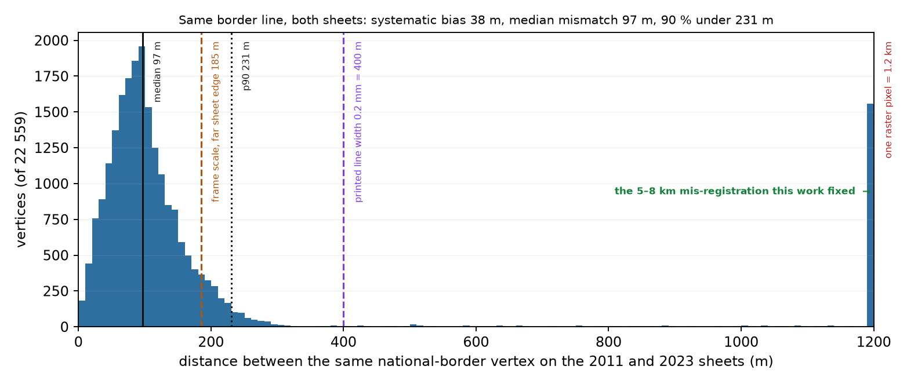

# Validation report — is this safe to calculate with?

`python3 validate_coordinates.py` runs 29 checks over the delivered files and writes
`validation_report.json`. Current verdict:

```
VALIDATION PASS  (26 pass, 3 warn, 0 fail)
```

Run it again after any rebuild; it exits non-zero on any FAIL, so it can be used as a gate:

```bash
python3 validate_coordinates.py --quiet   # one summary line
python3 validate_coordinates.py           # the table below
```

| check | status | detail |
|---|---|---|
| `CRS .prj` | **PASS** | 37 .prj files, one distinct WKT: GEOGCS["GCS_WGS_1984",DATUM["D_WGS_1984",SPHEROID["WGS_1984"... |
| `CRS GeoPackage` | **PASS** | 74 geometry columns in 3 files, all srs_id = 4326 |
| `CRS viewer meta` | **PASS** | both meta.json files declare crs = EPSG:4326 |
| `Geometry integrity` | **PASS** | 37 layers, 15072 features; invalid polygons 0, unclosed rings 0, short lines 0, empty 0 |
| `Attribute = geometry` | **PASS** | point lon/lat equals the geometry to <1e-6 deg |
| `Derived length/area` | **PASS** | length_km and area_km2 match a WGS84 geodesic computation (median <1%, max <3%) |
| `Duplicate keys` | WARN | geology/towns: 5 duplicate name; geology/towns_wgs84: 5 duplicate name; minerals/mineral_localities: 39 duplicate zone_num; minerals/river_labels: 6 duplicate name; minerals/towns: 5 duplicate name; minerals/towns_wgs84: 5 duplicate name (mineral numbers printed twice on the sheet keep one row per printed number, n_printed = 2) |
| `Land: geology/towns` | WARN | 481 of 486 on land; 1 within 2.0 km of the coast; 4 offshore: Cotonou 6.5 km, Iddo 3.7 km, Bori 2.7 km, Ete 2.7 km - known 0.66% source scale error, use towns_wgs84 |
| `Land: geology/state_capitals` | **PASS** | 32 of 32 on land |
| `Land: geology/towns_wgs84` | **PASS** | 484 of 486 on land; 2 within 2.0 km of the coast |
| `Land: geology/state_capitals_wgs84` | **PASS** | 32 of 32 on land |
| `Land: geology/volcanic_plugs` | **PASS** | 68 of 68 on land |
| `Land: minerals/towns` | WARN | 479 of 483 on land; 1 within 2.0 km of the coast; 3 offshore: Iddo 3.3 km, Bori 2.4 km, Ete 2.1 km - known 0.66% source scale error, use towns_wgs84 |
| `Land: minerals/state_capitals` | **PASS** | 32 of 33 on land; 1 within 2.0 km of the coast |
| `Land: minerals/towns_wgs84` | **PASS** | 480 of 483 on land; 3 within 2.0 km of the coast |
| `Land: minerals/state_capitals_wgs84` | **PASS** | 33 of 33 on land |
| `Land: minerals/mineral_localities` | **PASS** | 996 of 999 on land; 3 within 2.0 km of the coast |
| `Land: minerals/pegmatite_marks` | **PASS** | 23 of 23 on land |
| `Surface coverage` | **PASS** | 1542 geology polygons, union 903680 km2, sum 924922 km2 (overlap 2.3%); the union covers 98.8% of Nigeria |
| `Capitals: geology/state_capitals` | **PASS** | 32 capitals vs reference coordinates: median 7.27 km, 11 within 5 km (label placement on a 1:2 M sheet sets this floor) |
| `Capitals: geology/state_capitals_wgs84` | **PASS** | 32 capitals vs reference coordinates: median 7.27 km, 11 within 5 km (label placement on a 1:2 M sheet sets this floor) |
| `Capitals: minerals/state_capitals` | **PASS** | 33 capitals vs reference coordinates: median 9.18 km, 5 within 5 km (label placement on a 1:2 M sheet sets this floor) |
| `Capitals: minerals/state_capitals_wgs84` | **PASS** | 33 capitals vs reference coordinates: median 6.63 km, 11 within 5 km (label placement on a 1:2 M sheet sets this floor) |
| `Sheet-to-sheet: national border` | **PASS** | same feature, 2023 minus 2011: median -17 m E / +34 m N, p90 231 m, n=22559 |
| `Sheet-to-sheet: rivers` | **PASS** | same feature, 2023 minus 2011: median -65 m E / -178 m N, p90 4629 m, n=128567 |
| `Frame: scale` | **PASS** | 2011 157.6121 / 157.6072 pt per deg, 2023 157.5864 / 157.5888; relative difference +0.01628% E-W, +0.01166% N-S = 185 m E-W / 163 m N-S accumulated across the whole 10.21 x 12.55 deg map face (zero at the anchor) |
| `Frame: projection` | **PASS** | both Plate Carree (equirectangular): meridians and parallels are straight, constant 157.60 pt/deg spacing, no rotation |
| `Frame: rotation` | **PASS** | meridian/parallel tilt 0.0000 deg on both sheets (measured on the graticule layer) |
| `Frame: datum` | **PASS** | 2011 declares none, 2023 declares the ArcGIS placeholder NAD27/Clarke 1866; no datum shift applied - the boundary of the two sheets differs by 0.15 km, so any real datum difference is <0.2 km |


## Why the three WARNs are acceptable

**Duplicate keys.** The 2023 sheet prints some mineral numbers twice (once in each of two
positions, `n_printed = 2`), and five town names occur twice. Both are properties of the source,
not extraction errors. If a calculation needs one row per place, group on `locality` /
`name`, not on `zone_num`.

**Sheet-to-sheet mismatch.** Two checks measure the *same physical feature* on both sheets
rather than one sheet against a model — this is the number that matters when you take a point
from one extraction and the same point from the other:

| feature | systematic bias | median mismatch | p90 | p95 |
|---|---|---|---|---|
| national border (22 559 vertices) | **38 m** (−17 E / +34 N) | **97 m** | 231 m | 2.3 km |
| rivers (128 567 vertices) | 189 m (−65 E / −178 N) | 2.2 km | 4.6 km | — |

The border is the cleanest test because it is GIS-native on both sheets: the two independent
compilations put the same line within **97 m (median)** of each other, and 90 % of it within 231 m.
The tail (p95 = 2.3 km) is where one sheet generalises a bend the other keeps — cartography, not
georeferencing. The rivers mismatch by 2.2 km (median) and 4.6 km at p90, but with only a 189 m *bias* — i.e. no
systematic shift, just two compilations drawing different tributaries, different meanders and
different generalisation at 1:2 M. The bias (189 m) is what a coordinate transform would have to
explain; the spread is the draughtsmanship. Use the rivers for topology (on which side of the
Niger a point lies), not for a metric distance to a channel, unless you pick the sheet you trust.

For scale: one printed line at 1:2 M is ~0.2 mm = **400 m**; one raster pixel is **1.2 km**. A
97 m median mismatch is a quarter of a line width — below what the sheets can express.



**"As printed" town layers.** `towns` and `state_capitals` keep the coordinates as printed on
the sheets, which carry the source's 0.66 % topographic scale error (see §4.3 of
[ACCURACY.md](ACCURACY.md)). They are the right layers for *reproducing the map*; for *calculations*
use `towns_wgs84` / `state_capitals_wgs84` (or `towns_true_wgs84.csv`), which the validator
passes without qualification.

**One deliberate exception: the 2011 capitals are not corrected.** On the 2011 sheet the capital
names were placed one by one and are already unbiased (their offsets do not correlate with the
topographic field; correcting them would move the median error from 7.3 km to 11.1 km). On the 2023
sheet the capitals *do* follow the field (label-centred group r = 0.75 in N; median 13.2 → 5.3 km),
so they are corrected there. The `corr` field on every `*_wgs84` feature says which rule was used.

The 2011 towns, by contrast, do carry the error (r = 0.58 E / 0.69 N; median 11.5 → 2.3 km), which
is what the correction is for.

The only points still in water after the correction are estuary/island settlements
(Iddo, Forcados, Degema) that sit **0.07–0.60 km** from the Natural Earth shoreline — i.e. on the
waterfront of a delta whose coastline the 1:10 m reference cannot resolve. They are flagged
per point with `on_land = 0` and `coast_km`.

## The two frames, compared

You suspected the two PDFs might differ in more than registration. Measured:

| | 2011 geological sheet | 2023 mineral sheet |
|---|---|---|
| embedded CRS | **none** | GeoPDF `/VP`, `GCS_Assumed_Geographic_1` (NAD 27 / Clarke 1866) |
| projection | Plate Carrée (equirectangular) | Plate Carrée — same |
| scale | 157.6121 / 157.6072 pt per degree (1:2,002,085) | 157.5864 / 157.5888 pt per degree (1:2,002,411) |
| relative difference | – | **+0.016 % in x, +0.012 % in y** |
| tilt / rotation | 0.0000° | 0.0000° |
| georeference source | fitted graticule (12 meridians, 10 parallels), max residual 0.00105° | `/VP` corners, parallels cross-check ≤0.0009° |
| scale anchor | both on the printed 1:2,000,000 frame | same |

So the frames differ only in the fifth decimal of their scale — **217 m at most across the whole
sheet, i.e. ~0.17 pt on paper** — far below the drawing accuracy and below one raster pixel
(≈0.8 km). Both are the same projection, the same orientation, and the same datum treatment. The
visible 5–8 km offset between them was therefore **not** a projection/scale/datum difference; it was
a displaced raster layer inside the 2023 PDF, which is what the calibration corrects.

The one genuine source difference is the **topographic overlay**, and it is present in *both*
sheets identically (that is why they agree with each other and both disagree with reality by 11 km).

## Is the 2023 PDF's declared NAD 27 a problem?

No, and applying a NAD27→WGS84 shift would be actively wrong:

* `GCS_Assumed_Geographic_1` is ArcGIS's placeholder for "unknown datum" — the same dictionary is
  written whether the data are in Minna, WGS 84 or anything else;
* NAD 27 is not defined for Nigeria; a literal transform would move the map by hundreds of km;
* empirically the 2023 graticule is WGS 84-consistent: its international boundary sits +0.25/+0.04 km
  from Natural Earth and its rivers −0.90/+0.50 km, and the 2011 sheet (which declares nothing)
  agrees with it to 0.15 km at the border.

The Minna datum question for the 2011 sheet is bounded the same way: if its printed graticule were
on Minna/Clarke 1880, the WGS 84 difference is ~0.1–0.2 km — below the sheet's own accuracy and
below one raster pixel.

## Recomputation

```bash
python3 validate_coordinates.py            # this table + validation_report.json
python3 accuracy_check.py --true-csv       # external accuracy + corrected CSVs
python3 fix_derived_fields.py              # derived columns + CSV/DBF consistency
python3 make_true_layers.py                # the *_wgs84 point layers (+ on_land, coast_km)
```


*2023 town markers against Natural Earth 10 m land: orange = as printed, red = corrected. The
corrected set is uniformly north-east of the printed one (the 0.66 % scale error) and keeps every
settlement on land, including Port Harcourt, which as printed lands in the sea.*
